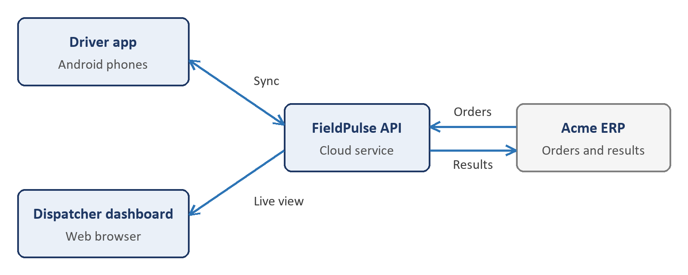

---
# Fictional example showing what a finished source file looks like. FieldPulse and Acme Logistics are made up.
type: SRS
project: FieldPulse
project_code: FIELDPULSE
client: Acme Logistics
version: 0.2
status: In review
date: 27 Oct 2026
prepared_by: Vishnu Ravi
reviewed_by: TBD
approved_by: TBD
classification: Confidential
revision: 0.1 | 20 Oct 2026 | Vishnu Ravi | First draft
revision: 0.2 | 27 Oct 2026 | Vishnu Ravi | Added offline requirements and NFRs after workshop 2
---

# 1. Introduction

## 1.1 Purpose

This document specifies the requirements for FieldPulse for Acme Logistics.

## 1.2 Scope

FieldPulse is an Android app that Acme's delivery drivers use to follow their route, capture proof of delivery and report failed deliveries. A web dashboard lets dispatchers follow deliveries as they happen. The first release covers Android phones and the dispatcher dashboard.

## 1.3 Definitions and abbreviations

| Term | Meaning |
|---|---|
| POD | Proof of delivery: a photo and the recipient's signature, captured at the door |
| Dispatcher | Acme staff member who assigns routes to drivers |
| ERP | Enterprise resource planning: Acme's system that holds orders |

## 1.4 References

| Document | Version | Location |
|---|---|---|
| Project Overview | 1.0 | FIELDPULSE_OVR_v1.0.docx |
| Workshop 2 notes | 24 Oct 2026 | [Shared drive](https://example.com/fieldpulse/workshop-2) |

# 2. Overall description

## 2.1 Product context

FieldPulse replaces the paper delivery sheets drivers use today. It reads each day's orders from Acme's ERP and sends delivery results back to it.



## 2.2 User roles

| Role | Description | What they can do |
|---|---|---|
| Driver | Delivers parcels | See their own route, capture POD, report a failed delivery |
| Dispatcher | Plans routes | Assign routes, follow drivers live, reassign stops |
| Administrator | Acme IT staff | Manage users and depots |

## 2.3 Assumptions

- Every driver has an Acme-issued Android phone running Android 10 or later.
- Acme's ERP offers an order API that FieldPulse can call.

## 2.4 Constraints

- Go-live date: TBD (owner: Acme operations head).
- Signatures must be kept for 7 years, as Acme's customer contracts require.

## 2.5 Dependencies

- ERP order API documentation from Acme IT.

# 3. Functional requirements

## 3.1 Routes

### FR-001: Show today's route

- **Priority:** Must
- **Description:** The system shall show drivers the stops assigned to them for the current day, in delivery order.
- **Acceptance criteria:**
  1. Given a driver with 12 assigned stops, when they open the app, then all 12 stops appear in the planned order.
  2. Given a stop reassigned by a dispatcher, when the driver's app next syncs, then the stop disappears from their route.
- **Source:** Workshop 1, 13 Oct 2026

### FR-002: Work offline

- **Priority:** Must
- **Description:** The system shall let drivers complete deliveries without a network connection and upload them when the connection returns.
- **Acceptance criteria:**
  1. Given the phone is offline, when the driver captures POD, then the POD is saved on the phone.
  2. Given saved PODs, when the connection returns, then they upload within 2 minutes without any action from the driver.
- **Source:** Workshop 2, 24 Oct 2026

## 3.2 Proof of delivery

### FR-003: Capture proof of delivery

- **Priority:** Must
- **Description:** The system shall capture a photo and the recipient's signature for each delivered parcel.
- **Acceptance criteria:**
  1. Given a stop, when the driver marks it delivered, then the app requires a photo and a signature before saving.
- **Source:** Workshop 1, 13 Oct 2026

> **Note:** Acme asked whether a one-time code sent to the customer could replace the signature. This is open question OQ-001.

# 4. Non-functional requirements

| ID | Category | Requirement | Target or measure | Source |
|---|---|---|---|---|
| NFR-001 | Performance | The app shall show the route screen within the target time after the driver opens it. | Under 2 seconds on a 4G connection for 95% of opens, on Acme's standard driver phone | Workshop 2, 24 Oct 2026 |
| NFR-002 | Availability | The dispatcher dashboard shall be available during delivery hours. | 99.5% between 06:00 and 22:00 IST, measured monthly | Workshop 2, 24 Oct 2026 |
| NFR-003 | Security | The system shall encrypt delivery data in transit and at rest. | TLS 1.2 or later in transit; AES-256 at rest | Acme IT security policy v3 |

# 5. External interfaces

## 5.1 User interfaces

Android phones with 5 to 7 inch screens, in English and Hindi. Designs: TBD (owner: Panasa design lead).

## 5.2 APIs

| API | Direction | Purpose | Format and authentication |
|---|---|---|---|
| ERP order API | Outbound | Read the day's orders | REST and JSON, OAuth 2.0 client credentials |
| Delivery results API | Outbound | Send delivery results to the ERP | REST and JSON, OAuth 2.0 client credentials |

A delivery result sent to the ERP looks like this:

```json
{
  "orderId": "ACM-104233",
  "status": "DELIVERED",
  "deliveredAt": "2026-10-27T10:42:00+05:30"
}
```

## 5.3 Third-party integrations

| System | Purpose | Owned by | Notes |
|---|---|---|---|
| Google Maps Platform | Maps and turn-by-turn directions | Acme Logistics | Billing and keys sit in Acme's Google Cloud project |

# 6. Data requirements

| Data | Description | Personal data | Retention |
|---|---|---|---|
| Delivery record | Stop address, time, status and driver | Yes (driver and delivery address) | 7 years |
| Proof of delivery | Photo and signature | Yes | 7 years |
| Driver location | GPS position during shifts | Yes | 90 days |

# 7. Out of scope

- iOS app
- A tracking page for Acme's customers

# 8. Open questions

| ID | Question | Raised by | Owner | Due date | Status |
|---|---|---|---|---|---|
| OQ-001 | Can a one-time code replace the customer's signature? | Acme operations | Acme legal | 07 Nov 2026 | Open |

# 9. Sign-off

By signing below, the parties agree that this document describes the requirements for FieldPulse. Once signed, it is the agreed basis for design, development, testing and acceptance.

| Name | Organisation | Role | Signature | Date |
|---|---|---|---|---|
| TBD (owner: Acme project sponsor) | Acme Logistics | Product owner | | |
| TBD (owner: Panasa delivery head) | Panasa | Project manager | | |
